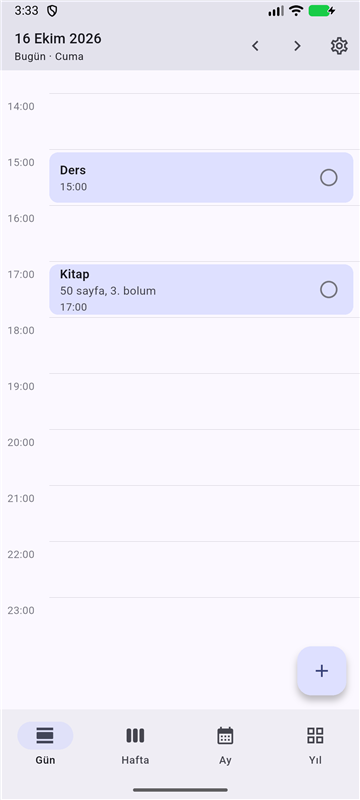
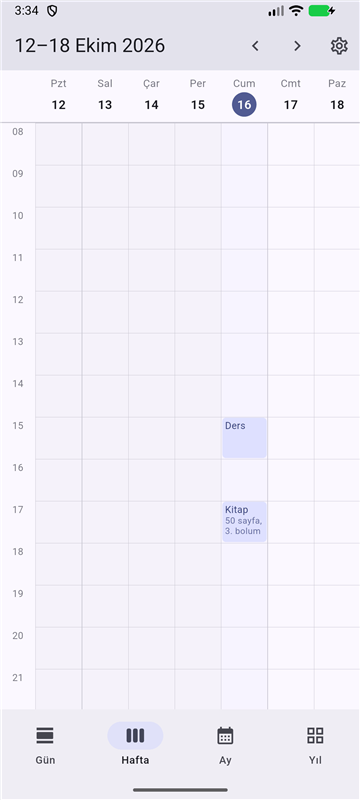
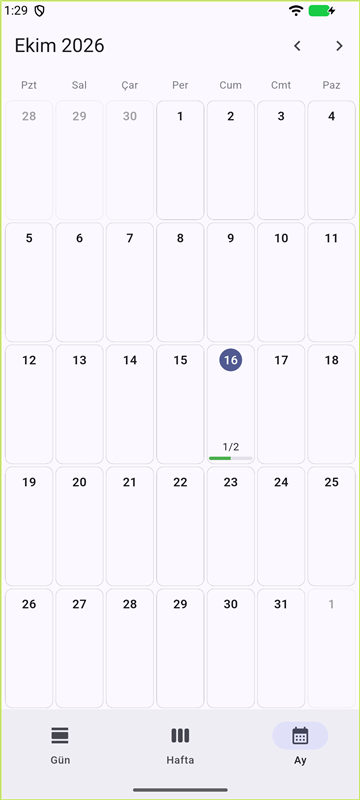
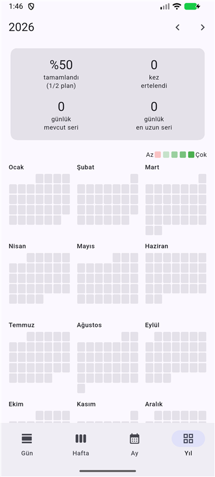
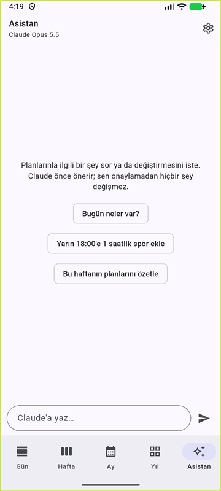
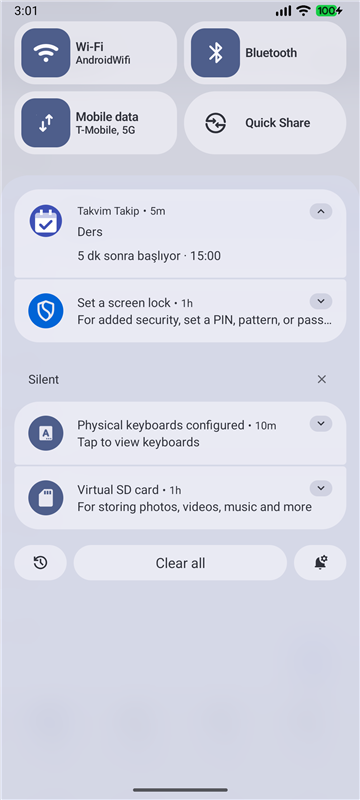
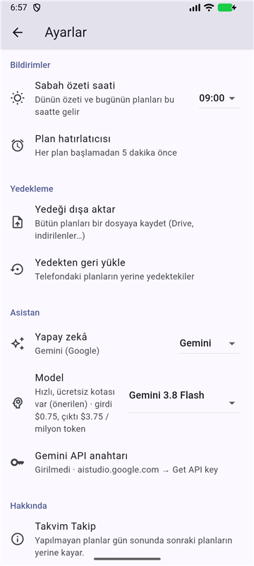

# Takvim Takip

Saatlik planlarını takip eden, **yapmadığın planı otomatik olarak sonraki
plan saatine kaydıran** kişisel Android uygulaması.

<p>
  
  
  
  
</p>

## Özellikler

- **Yürüyen bant:** Gün 23:59'da kapanınca işaretlemediğin plan, sıradaki
  plan saatine kayar; oradaki plan bir sonrakine… Boş saatlerine (uyku!) ve
  📌 sabit planlara dokunulmaz. Kaç kez ertelendiği sayılır.
- **Saatlik planlar:** `13:00 Ders` ya da `13:00–15:00 Ders`; not, sabit, iptal.
- **Görünümler:** Gün · e-tablo gibi Hafta · Ay · Yıl (GitHub tarzı renkli
  kutucuklar, seriler, en çok ertelenenler).
- **Bildirimler:** Sabah özeti ("Dün 1 plan yapılmadı, 4 plan kaydı…") ve her
  plandan 5 dakika önce hatırlatıcı. Uygulama kapalıyken de çalışır.
- **Yedekleme:** Tek dosyaya dışa aktar / geri yükle.
- **Yapay zekâ asistanı (isteğe bağlı):** "Yarın 18:00'e spor ekle" de;
  asistan önizleme gösterir, sen onaylarsın. **Claude, ChatGPT, Gemini ya da
  DeepSeek**'ten birini seç; kendi API anahtarınla (Gemini'nin ücretsiz kotası
  var).
- İnternet hesabı yok, reklam yok; veriler telefonda. Türkçe.

<p>
  
  
  
</p>

## Kurulum (Android 7.0+)

1. Telefondan **[Releases → son sürüm](https://github.com/enesilhan1/TakvimTakip/releases/latest)** sayfasına git
   ve `.apk` dosyasını indir.
2. Dosyayı aç → "bilinmeyen uygulamalar" iznini ver → **Yükle**
   (Play Protect uyarısında *Yine de yükle*).
3. İlk açılışta **bildirim iznine** izin ver.

Adım adım anlatım, yapay zekâ asistanının kurulumu ve ücretlendirmesi, yedekleme
ve sorun giderme: **[docs/KURULUM.md](docs/KURULUM.md)**

## Nasıl çalışır

```
Pazartesi                    Salı (önce)          Salı (sonra)
13:00 Ders    ✅             13:00 Ders           13:00 Kitap   (1 kez yapılmadı)
14:00 Spor    ✅             14:00 📌 Spor        14:00 📌 Spor (sabit, atlanır)
15:00 Kitap   ⏳ yapılmadı   15:00 Kitap2         15:00 Ders
                                                  → Kitap2 bir sonraki plan saatine
```

Bütün kurallar ve örnekler: [docs/SPEC.md](docs/SPEC.md)

---

## Geliştirme

```bash
flutter pub get
flutter test
flutter run                  # bağlı telefon veya emülatörde çalıştırır
flutter build apk --release  # build/app/outputs/flutter-apk/app-release.apk
```

Gereksinimler: Flutter 3.41+, JDK 21 (`flutter config --jdk-dir` ile; Android
Studio'nun içindeki Java 25 Gradle 8.14 ile çalışmaz), Android SDK.

Kod yapısı:

| Klasör | İçerik |
|---|---|
| `lib/logic/` | Kaydırma motoru, istatistik, bildirim planı, yedek biçimi (saf Dart, testli) |
| `lib/data/` | SQLite şeması ve `PlanDeposu` |
| `lib/ui/` | Ekranlar |
| `lib/platform/` | Bildirimler ve gece yarısı arka plan görevi |
| `lib/asistan/` | Yapay zekâ asistanı: sağlayıcı bağlayıcıları (Claude, OpenAI, Gemini, DeepSeek) ve sohbet döngüsü |
| `test/` | Birim ve widget testleri |

### Sürüm imzası

Sürüm APK'sı `android/takvim_takip.jks` anahtarıyla imzalanır; şifreler
`android/key.properties` dosyasındadır. İkisi de git'e **girmez**.

- Bu iki dosyayı güvenli bir yere **yedekle**. Kaybolursa yeni sürümler
  kurulu uygulamanın üstüne kurulamaz.
- Projeyi kendin derliyorsan bu dosyalar olmadan debug anahtarıyla
  imzalanır; o APK, Releases'teki sürümün üstüne kurulmaz (önce kaldırman
  gerekir).

## Lisans

[MIT](LICENSE) © 2026 Enes İlhan
