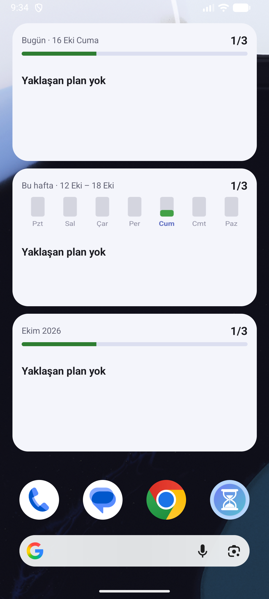
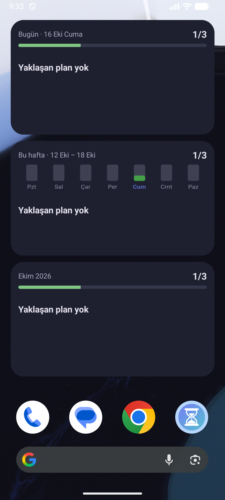

# Takvim Takip — Kurulum Rehberi

Bu rehber, Takvim Takip'i kendi Android telefonuna kurmak isteyenler için.
Bilgisayara, geliştirici araçlarına ya da hesap açmaya gerek yok.

- [Gereksinimler](#gereksinimler)
- [1. APK dosyasını indir](#1-apk-dosyasını-indir)
- [2. Telefona kur](#2-telefona-kur)
- [3. İlk açılış](#3-ilk-açılış)
- [4. (İsteğe bağlı) Yapay zekâ asistanını bağla](#4-isteğe-bağlı-yapay-zekâ-asistanını-bağla)
- [5. (İsteğe bağlı) Ana ekran widget'ı ekle](#5-isteğe-bağlı-ana-ekran-widgetı-ekle)
- [Güncelleme](#güncelleme)
- [Yedekleme ve telefon değiştirme](#yedekleme-ve-telefon-değiştirme)
- [Sorun giderme](#sorun-giderme)
- [Gizlilik](#gizlilik)

---

## Gereksinimler

| | |
|---|---|
| Telefon | Android 7.0 veya üstü |
| Yer | ~60 MB |
| İnternet | Gerekmez (yalnızca isteğe bağlı yapay zekâ asistanı için) |
| iPhone | Şu an desteklenmiyor |

## 1. APK dosyasını indir

1. Telefonundan bu projenin GitHub sayfasındaki **Releases** bölümüne git:
   **[Son sürüm](https://github.com/enesilhan1/TakvimTakip/releases/latest)**
2. **Assets** altında `.apk` ile biten dosyaya dokun
   (ör. `TakvimTakip-1.2.0.apk`) ve indir.

> Bilgisayardan indirdiysen dosyayı telefona kabloyla, Google Drive'la ya da
> kendine e-postayla gönder.

## 2. Telefona kur

1. İndirilenlerden (ya da bildirimden) APK dosyasına dokun.
2. **"Bilinmeyen uygulamaları yükleme"** izni istenirse: *Ayarlar*'a dokun ve
   dosyayı açtığın uygulama (Chrome, Dosyalar, Drive…) için **İzin ver**'i aç,
   sonra geri dön.
3. **Yükle**'ye dokun.
4. **Play Protect** "tanınmayan uygulama" uyarısı gösterebilir. Uygulama Play
   Store'dan gelmediği için normaldir: *Ayrıntılar → Yine de yükle*.

## 3. İlk açılış

1. **Bildirim izni** sorulur → **İzin ver**. Sabah özeti ve planlardan
   5 dakika önceki hatırlatıcılar için gerekli.
2. **Pil ayarı (önerilir).** Bazı telefonlar (Xiaomi, Samsung, Huawei, Oppo…)
   pil tasarrufu için arka plan alarmlarını geciktirebilir:
   *Ayarlar → Uygulamalar → Takvim Takip → Pil* → **Kısıtlama yok** (ya da
   *Optimize etme*). Böylece gece yarısı kaydırması ve hatırlatıcılar tam
   zamanında çalışır. (Seçmesen de kaydırma, uygulamayı açtığında mutlaka
   yapılır.)
3. Hazır! Bir saate dokun, planını yaz.

### Nasıl çalışır (kısaca)

| | |
|---|---|
| Plan ekle | Boş bir saate dokun (ya da **+**). Tam saatte başlar, 1+ saat sürebilir. |
| İşaretle | Sağdaki daireye dokun → ✅ yapıldı. Karta dokun → yapıldı / iptal / düzenle / sil. |
| 📌 Sabit | Yapılmasa da hiç kaymaz (doktor randevusu gibi). |
| 🚫 İptal | Yapılmayacak ama ertelenmesin de. |
| Gün sonu | 23:59'da işaretlenmeyen planlar **sonraki plan saatine kayar**; oradaki plan bir sonrakine… Boş saatlere ve sabit planlara dokunulmaz. |
| Görünümler | Gün · Hafta (tablo) · Ay · Yıl (renkli kutucuklar ve istatistik) |

Ayrıntılı kurallar: [docs/SPEC.md](SPEC.md)

## 4. (İsteğe bağlı) Yapay zekâ asistanını bağla

**Asistan** sekmesinde planlarını yazarak düzenletebilirsin:
*"Yarın 18:00'e 1 saatlik spor ekle"*, *"Bugünkü dersi cumartesiye al"*.
Asistan önce bir **önizleme** gösterir; sen **Onayla** demeden hiçbir plan
değişmez.

Dört yapay zekâdan birini seçebilirsin. Hangisini kullanacaksan onun
**kendi API anahtarı** gerekir:

| Yapay zekâ | Anahtarı nereden alırsın | Not |
|---|---|---|
| **Claude** (Anthropic) | [console.anthropic.com](https://console.anthropic.com) → API Keys | Varsayılan. Billing'den kredi yükle. |
| **ChatGPT** (OpenAI) | [platform.openai.com](https://platform.openai.com) → API keys | Billing'den kredi yükle. |
| **Gemini** (Google) | [aistudio.google.com](https://aistudio.google.com) → Get API key | **Ücretsiz kotası var** (dakikalık/günlük sınırlı). |
| **DeepSeek** | [platform.deepseek.com](https://platform.deepseek.com) → API keys | Çok ucuz. Top up'tan bakiye yükle. |

1. Seçtiğin sağlayıcıda hesap aç, gerekiyorsa kredi yükle ve bir API
   anahtarı oluşturup kopyala.
2. Uygulamada ⚙ *Ayarlar → Asistan* → **Yapay zekâ**'dan sağlayıcıyı seç.
3. **… API anahtarı** satırına dokun → yapıştır → **Kaydet**.
4. İstersen **Model**'den başka bir model seç. Listede olmayan yeni bir
   model için **Diğer…** ile adını elle yazabilirsin (fiyatı bilinmediği için
   o zaman maliyet gösterilmez).

Her sağlayıcının anahtarı ayrı saklanır; aralarında geçiş yapınca
anahtarların silinmez.

### Ücretlendirme hakkında

- API kullanımı **ChatGPT Plus, Claude Pro, Gemini Advanced gibi
  aboneliklerden ayrıdır** ve onlara dahil değildir. Sağlayıcının API
  hesabına yüklediğin ön ödemeli krediden düşer (Gemini'nin ücretsiz kotası
  hariç).
- Kredi bitince istekler durur; kendiliğinden fazla ücret çekilmez. Çoğu
  sağlayıcıda aylık harcama sınırı da koyabilirsin.
- Hazır modeller ve fiyatları (milyon token başına, girdi / çıktı, Ekim 2026):

  | Yapay zekâ | Model | Fiyat | Not |
  |---|---|---|---|
  | Claude | Opus 5.5 | 4 $ / 20 $ | Varsayılan, en akıllısı |
  | | Sonnet 5.5 | 2 $ / 10 $ | Hızlı, yarı fiyatına |
  | | Haiku 5.5 | 0,10 $ / 0,50 $ | En ucuzu |
  | ChatGPT | GPT-6.1 Sol | 2 $ / 10 $ | Önerilen |
  | | GPT-6 Astra | 10 $ / 50 $ | En güçlüsü, pahalı |
  | | GPT-6 Luna | 0,10 $ / 0,50 $ | En ucuzu |
  | Gemini | 3.8 Flash | 0,75 $ / 3,75 $ | Önerilen, ücretsiz kotası var |
  | | 4 Argon | 2 $ / 10 $ | En güçlüsü, ücretsiz kotası yok |
  | | 3.5 Flash-Lite | 0,30 $ / 2,50 $ | Ücretsiz kotası var |
  | DeepSeek | Flash | 0,30 $ / 1,20 $ | Gece saatlerinde yarı fiyatına |
  | | V4 Pro | 1,32 $ / 3,96 $ | Daha güçlü |

  "Yarına plan ekle" gibi tek bir istek çoğu modelde 1 sentin altındadır.
  Sohbet ekranının altında yaklaşık maliyet yazar. Fiyatlar sağlayıcılar
  tarafından değiştirilebilir; güncelini sağlayıcının sayfasından kontrol et.
## 5. (İsteğe bağlı) Ana ekran widget'ı ekle

Ana ekranda boş bir yere **basılı tut → Widget'lar → Takvim Takip**. Üç
seçenek var: **Bugün**, **Bu hafta** (7 günlük grafikli), **Bu ay**. Birini
sürükleyip bırak.

- Widget kaç planın olduğunu, kaçını bitirdiğini ve şu anki (yoksa
  sıradaki) planı notuyla gösterir.
- **✓ Yapıldı** butonuyla planı uygulamayı açmadan işaretlersin.
- Kenarından tutup **büyütürsen** sonraki planlar da listelenir.
- Widget'a dokununca uygulama ilgili görünümde açılır.
- Widget "Uygulamayı bir kez aç" diyorsa uygulamayı bir kez açıp kapat.

  
  

## Güncelleme

Yeni sürümün APK'sını aynı şekilde indirip kur; mevcut uygulamanın üstüne
kurulur, **planların silinmez**. Önce kaldırmana gerek yok.

## Yedekleme ve telefon değiştirme

Planlar yalnızca telefonda saklanır (internet hesabı yok).

- **Yedek al:** ⚙ *Ayarlar → Yedeği dışa aktar* → dosyayı Drive'a ya da
  İndirilenler'e kaydet.
- **Yeni telefona taşı:** uygulamayı kur → ⚙ *Ayarlar → Yedekten geri yükle* →
  dosyayı seç.
- API anahtarları güvenlik için yedeğe girmez; yeni telefonda tekrar gir.

Ara sıra yedek almanı öneririz.

## Sorun giderme

| Sorun | Çözüm |
|---|---|
| "Uygulama yüklenmedi" | Telefonda farklı imzalı eski bir sürüm olabilir. Önce yedek al, eskisini kaldır, sonra kur. |
| Bildirimler gelmiyor | *Ayarlar → Uygulamalar → Takvim Takip → Bildirimler* açık mı? Pil ayarını **Kısıtlama yok** yap ([İlk açılış](#3-ilk-açılış)). |
| Widget güncellenmiyor | Uygulamayı bir kez aç; pil ayarını **Kısıtlama yok** yap. Widget'ı kaldırıp yeniden eklemek de işe yarar. |
| Gece kaydırma olmamış | Pil kısıtlaması olabilir; uygulamayı açınca kaçırılan günler sırayla işlenir. |
| Asistan: "İnternet bağlantısı yok" | İnterneti kontrol et. Devam ediyorsa en son sürümü kur (1.0.0'ın ilk derlemelerinde internet izni eksikti). |
| Asistan: "API anahtarı geçersiz" | Anahtarı sağlayıcının sayfasından yeniden kopyala; doğru sağlayıcıyı seçtiğinden emin ol. |
| Asistan: "bakiyesi yetersiz" / "kredi yok" | Sağlayıcının Billing / Top up bölümünden kredi yükle. |
| Asistan: "kotan doldu" (Gemini) | Ücretsiz kotanın dakikalık/günlük sınırı doldu; biraz bekle. |
| Asistan: "Model bulunamadı" | Elle yazdığın model adını kontrol et ya da listeden bir model seç. |

## Gizlilik

- Planların **yalnızca telefonunda** saklanır; uygulamanın sunucusu yok,
  reklam ve izleme yok.
- Yalnızca asistanı kullandığında, o sohbetin mesajları ve önümüzdeki 14
  günün planları seçtiğin sağlayıcıya (Anthropic, OpenAI, Google ya da
  DeepSeek) gönderilir.
- API anahtarların telefonda Android Keystore ile şifreli saklanır.
